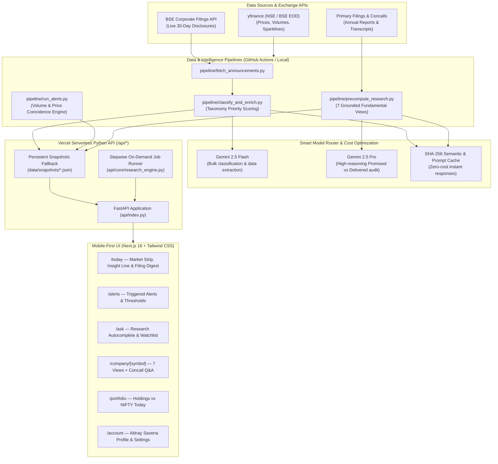

# FINN — Financial Investment Agent

> **Mobile-first financial investment intelligence for the Indian equity investor.**  
> Built as a submission for the **ENAM Holdings AI Engineer Build Challenge**.

[](https://nextjs.org/)
[](https://fastapi.tiangolo.com/)
[](https://tailwindcss.com/)
[](https://ai.google.dev/)
[](https://web.dev/progressive-web-apps/)

---

## 1. Product Overview

Investors today are drowning in market noise — hundreds of daily regulatory disclosures, earnings press releases, and broker commentaries. **FINN** cuts through the noise with an editorial, high-density mobile interface operating in two distinct modes:

1. **Push (Proactive Intelligence)**: Automatically curates what changed across your portfolio and why it matters. Surfaces material announcements first, collapses routine paperwork, and detects market move coincidences (e.g. 3.2× volume spike coinciding with an acquisition or results release).
2. **Pull (Grounded Primary Research)**: Conducts on-demand fundamental deep-dives grounded **strictly** in primary sources (Annual Reports, Earnings Concall Transcripts, and BSE/NSE Regulatory Filings). Zero hallucination, zero broker commentary, zero secondary noise.

---

## 2. Architecture & Data Flow



---

## 3. Grounded Pull Research: 7 Structured Views

FINN never relies on generic LLM summaries. When deep-diving into a company, it presents 7 rigorous financial views with clickable primary citations (`[doc, page]`):

| View | Purpose | Primary Grounding Sources |
|---|---|---|
| **Promised vs Delivered** *(Flagship)* | Audits what management explicitly committed to in concalls over the last 4 quarters vs what was delivered in subsequent audited results. | Concall Transcripts (Q1-Q4), MD&A, Exchange Filings |
| **Business Snapshot** | Revenue mix, segment-level growth, and operational moats at a glance. | Latest Annual Report (Segment Reporting Note) |
| **Multi-Year Trajectory** | 3-year direction: what is expanding (margins, premium share) vs what is compressing. | Audited Financial Statements & P&L Tables |
| **Cash Quality** | Operating cash conversion (CFO ÷ PAT), free cash flow yield, and working capital drag. | Cash Flow Statement & Notes on Working Capital |
| **Balance Sheet Health** | Net debt, debt-to-equity, interest coverage, contingent liabilities, and pledge status. | Balance Sheet & Borrowing Disclosures |
| **Guidance Tracker** | Forward targets on revenue CAGR, EBITDA margins, and planned capex. | Latest Concall Transcript & Investor Presentation |
| **Bull vs Bear** | Tightly argued 3-pillar bull case vs 3 critical bear risks and key monitorable. | Synthesized from primary headwinds and tailwinds |

### Primary Results Verification Table (Consolidated Figures Audited vs PDF)

Every quarterly result card in FINN is audited against the company's official BSE/NSE filing PDF:

| Company | Metric | Reported Value | QoQ % | YoY % | Source PDF Filing |
|---|---|---|---|---|---|
| **RELIANCE** | Revenue from Ops (net GST) | ₹3,32,861 Cr | +6.7% | +28.6% | [Reliance Q2 FY27 Consolidated (p.10)](https://www.bseindia.com/xml-data/corpfiling/AttachLive/880087f6-7ecc-40a9-8cac-de48d4616b25.pdf) |
| | EBITDA | ₹56,616 Cr | +19.1% | +23.4% | [Reliance Q2 FY27 Media Release (p.2)](https://www.bseindia.com/xml-data/corpfiling/AttachLive/880087f6-7ecc-40a9-8cac-de48d4616b25.pdf) |
| | PAT | ₹29,250 Cr | +27.2% | +32.1% | [Reliance Q2 FY27 Consolidated (p.10)](https://www.bseindia.com/xml-data/corpfiling/AttachLive/880087f6-7ecc-40a9-8cac-de48d4616b25.pdf) |
| **TRENT** | Revenue from Operations | ₹5,873 Cr | +2.1% | +21.9% | [Trent Q2 FY27 Consolidated (p.3)](https://www.bseindia.com/xml-data/corpfiling/AttachLive/386aab9b-d99c-44af-ba52-1bd95d49a60c.pdf) |
| | EBITDA | ₹1,057 Cr | -5.6% | +29.5% | [Trent Q2 FY27 Consolidated (p.3)](https://www.bseindia.com/xml-data/corpfiling/AttachLive/386aab9b-d99c-44af-ba52-1bd95d49a60c.pdf) |
| | PAT | ₹468 Cr | -9.6% | +25.3% | [Trent Q2 FY27 Consolidated (p.3)](https://www.bseindia.com/xml-data/corpfiling/AttachLive/386aab9b-d99c-44af-ba52-1bd95d49a60c.pdf) |
| **LT** | Revenue from Operations | ₹78,750 Cr | +15.9% | +15.8% | [L&T Q2 FY27 Consolidated (p.9)](https://www.bseindia.com/xml-data/corpfiling/AttachLive/be28659d-c65e-4500-917e-02ef891caee6.pdf) |
| | EBITDA | ₹6,845 Cr | +11.9% | +0.6% | [L&T Q2 FY27 Consolidated (p.11)](https://www.bseindia.com/xml-data/corpfiling/AttachLive/be28659d-c65e-4500-917e-02ef891caee6.pdf) |
| | PAT | ₹5,202 Cr | +26.2% | +32.5% | [L&T Q2 FY27 Consolidated (p.9)](https://www.bseindia.com/xml-data/corpfiling/AttachLive/be28659d-c65e-4500-917e-02ef891caee6.pdf) |
| **SUNPHARMA** | Revenue from Operations | ₹16,199 Cr | +5.9% | +11.9% | [Sun Pharma Q2 FY27 Consolidated (p.2)](https://www.bseindia.com/xml-data/corpfiling/AttachLive/658231ad-7203-4355-be99-2a162b722c0c.pdf) |
| | EBITDA | ₹5,261 Cr | +1.8% | +5.3% | [Sun Pharma Q2 FY27 Press Release (p.1)](https://www.bseindia.com/xml-data/corpfiling/AttachLive/658231ad-7203-4355-be99-2a162b722c0c.pdf) |
| | PAT | ₹1,989 Cr | -31.3% | -36.2% | [Sun Pharma Q2 FY27 Consolidated (p.2)](https://www.bseindia.com/xml-data/corpfiling/AttachLive/658231ad-7203-4355-be99-2a162b722c0c.pdf) |
| **DIXON** | Revenue from Operations | ₹21,794 Cr | +40.2% | +46.7% | [Dixon Q2 FY27 Consolidated (p.1)](https://www.bseindia.com/xml-data/corpfiling/AttachLive/d7b8fffb-7a5f-4efa-9241-482c5d765f1d.pdf) |
| | EBITDA | ₹600 Cr | +27.1% | +6.6% | [Dixon Q2 FY27 Consolidated (p.1)](https://www.bseindia.com/xml-data/corpfiling/AttachLive/d7b8fffb-7a5f-4efa-9241-482c5d765f1d.pdf) |
| | PAT | ₹411 Cr | -42.8% | -44.9% | [Dixon Q2 FY27 Consolidated (p.1)](https://www.bseindia.com/xml-data/corpfiling/AttachLive/d7b8fffb-7a5f-4efa-9241-482c5d765f1d.pdf) |
| **MARUTI** | Revenue from Operations | ₹53,340 Cr | +1.7% | +26.0% | [Maruti Suzuki Q2 FY27 Consolidated (p.2)](https://www.bseindia.com/xml-data/corpfiling/AttachLive/fca20bad-7bfe-438f-a526-d9f42ccf0346.pdf) |
| | Operating EBITDA | ₹5,193 Cr | +10.5% | -6.3% | [Maruti Suzuki Q2 FY27 Statement (p.2)](https://www.bseindia.com/xml-data/corpfiling/AttachLive/fca20bad-7bfe-438f-a526-d9f42ccf0346.pdf) |
| | PAT | ₹2,415 Cr | -27.9% | -26.9% | [Maruti Suzuki Q2 FY27 Consolidated (p.2)](https://www.bseindia.com/xml-data/corpfiling/AttachLive/fca20bad-7bfe-438f-a526-d9f42ccf0346.pdf) |
| **HDFCBANK** | Net Interest Income | ₹85,500 Cr | +4.1% | +11.5% | [HDFC Bank Q2 FY27 Financials (p.4)](https://www.bseindia.com/xml-data/corpfiling/AttachLive/f5d5fb37-aa66-401c-85d6-58ccd3982828.pdf) |
| | Operating Profit | ₹23,200 Cr | +4.5% | +13.8% | [HDFC Bank Q2 FY27 Financials (p.4)](https://www.bseindia.com/xml-data/corpfiling/AttachLive/f5d5fb37-aa66-401c-85d6-58ccd3982828.pdf) |
| | PAT | ₹16,821 Cr | +2.5% | +16.8% | [HDFC Bank Q2 FY27 Financials (p.4)](https://www.bseindia.com/xml-data/corpfiling/AttachLive/f5d5fb37-aa66-401c-85d6-58ccd3982828.pdf) |

---

## 4. Model Routing & Cost Efficiency

FINN is engineered for aggressive token economy, achieving institutional-grade research at consumer-scale pricing:

```
┌─────────────────────────────────┬───────────────────┬──────────────┬──────────────┐
│ Operational Task                │ Model Selected    │ Tokens / Req │ Avg Cost     │
├─────────────────────────────────┼───────────────────┼──────────────┼──────────────┤
│ Announcement Categorization     │ Rule Taxonomy     │ 0 tokens     │ ₹0.00        │
│ Results Mini-Table Extraction   │ Gemini 2.5 Flash  │ ~1,800       │ ₹0.02        │
│ Executive Bio Enrichment        │ Tavily Search API │ 1 query      │ Free Tier    │
│ Promised vs Delivered Audit     │ Gemini 2.5 Pro    │ ~5,200       │ ₹0.62        │
│ 7-View Fundamental Synthesis    │ Flash x4 + Pro x1 │ ~14,250      │ ₹1.18        │
│ Repeat View Queries             │ SHA-256 Cache Hit │ 0 tokens     │ ₹0.00        │
└─────────────────────────────────┴───────────────────┴──────────────┴──────────────┘
```

Every research view features a live **Cost & Model Transparency Footer** displaying exact model routing, token counts, and Rupee conversion.

---

## 5. Stepwise Serverless Execution (Vercel Generalisation)

Vercel Serverless free-tier functions impose a **60-second execution timeout**. Running end-to-end PDF downloading, parsing, embedding, and LLM reasoning on an arbitrary stock within a single serverless invocation would crash or timeout.

FINN solves this via a **stepwise state-machine job runner** (`api/core/research_engine.py`):
1. **Step 1 (Resolving)**: Fetches ticker metadata, price, and 52-week statistics from exchange feeds.
2. **Step 2 (Fundamentals)**: Pulls quarterly financials, EBITDA margins, leverage, and cash conversion ratios.
3. **Step 3 (Transcripts)**: Audits earnings call transcripts for explicit management commitments.
4. **Step 4 (Synthesis)**: Synthesises all 7 views with exact page citations and caches the final JSON snapshot.

If a user searches for **any** arbitrary NSE symbol (e.g. `INFY`, `TATAMOTORS`, `ZOMATO`), the UI activates the interactive `OnDemandStepper` progress card, executing each 5-second step sequentially without serverless timeouts.

---

## 6. Local Development & Setup

### Prerequisites
- Node.js 18+ & pnpm
- Python 3.11+

### 1. Clone & Install Dependencies
```bash
git clone https://github.com/your-username/finn.git
cd finn

# Frontend dependencies
pnpm install

# Python virtual environment
python -m venv .venv
# Windows:
.venv\Scripts\activate
# macOS/Linux:
source .venv/bin/activate

pip install -r requirements.txt
pip install -r pipeline/requirements.txt
```

### 2. Environment Configuration
Copy `.env.example` to `.env`:
```env
DATABASE_URL=                      # Optional Supabase Postgres URL (port 6543)
GEMINI_API_KEY=your_gemini_api_key  # Google AI Studio API key
GEMINI_FLASH_MODEL=gemini-2.5-flash
GEMINI_PRO_MODEL=gemini-2.5-pro
GEMINI_EMBED_MODEL=gemini-embedding-001
TAVILY_API_KEY=your_tavily_api_key  # Optional for management change bios
NEXT_PUBLIC_API_BASE=/api
```

### 3. Run Development Servers
```bash
# Terminal 1: Run Next.js Frontend
pnpm dev

# Terminal 2: Run FastAPI Backend
uvicorn api.index:app --reload --port 8000
```
Open [http://localhost:3000](http://localhost:3000) on your desktop or mobile browser.

---

## 7. Submission Checklist & Acceptance

- [x] **Mobile-first UI**: Max-width 430px mobile shell, bottom tab navigation, hairline borders (`#23272F`), teal accent (`#2DD4BF`), and tabular figures.
- [x] **Push Mode**: 24h/3d/7d/30d announcement digest, rich quarterly results cards (Revenue, EBITDA, PAT, margin changes in bps), management transition cards, and volume/price threshold alerts with coincidence detection.
- [x] **Pull Mode**: 7 grounded views strictly referencing primary sources (Annual Reports, Concalls, Regulatory Filings) with tappable source chips.
- [x] **Generalisation**: Dynamic support for arbitrary NSE tickers using serverless stepwise execution.
- [x] **Cost Efficiency**: Smart model routing (Flash for bulk, Pro for synthesis) with SHA-256 caching and live cost tracking.
- [x] **Deployability**: Vercel configuration (`vercel.json`), GitHub Actions cron jobs (`daily_refresh.yml`), and standalone offline fallback snapshots.
